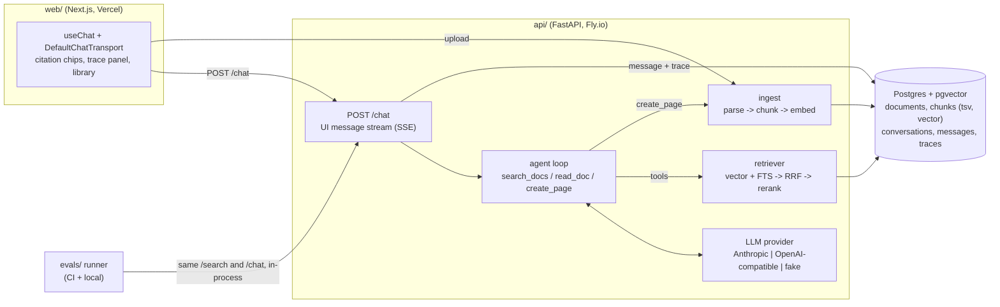

# DocPilot

Upload documents (PDF, Markdown, HTML) and chat with an agent that answers from them, cites the exact
source chunk for every claim, and can draft new pages back into your library. Every answer comes with
a trace (retrieved chunks, tool calls, tokens, latency, cost), and an eval suite scores retrieval and
answer quality on every PR.

- **Agentic RAG:** the model decides when to call `search_docs`, `read_doc` and `create_page`. Search is not hard-wired into every turn.
- **Hybrid retrieval:** Postgres full-text and pgvector results are fused with reciprocal rank fusion (RRF), then optionally reranked. The retrieval mode is a flag, so ablations are one command.
- **Streaming with inline citations:** FastAPI emits the Vercel AI SDK UI message stream, and the Next.js `useChat` renders `[c:<id>]` markers as clickable chips.
- **One Postgres holds everything:** documents, chunks, vectors, conversations and traces.
- **Evals in CI:** 110 labeled questions over a fixed corpus. The workflow reports recall@5, MRR, LLM-judged correctness, citation faithfulness and refusals, and posts the diff against a baseline as a PR comment.

## Architecture



**One chat turn:**
1. The client POSTs `{id, messages}`.
2. The API loads earlier turns from Postgres and runs the agent loop: stream a model turn, run the tools it asked for, send all results back in one message, and repeat (at most `MAX_AGENT_STEPS` turns).
3. Text and tool events are streamed as UI-stream parts.
4. At the end, the API resolves the cited chunk ids against the DB (a hallucinated id produces no citation), saves the message and its `traces` row, and sends `data-citations` and `data-trace` parts.

## Quickstart (Docker)

```bash
cp .env.example .env            # add ANTHROPIC_API_KEY + OPENAI_API_KEY (embeddings)
docker compose up --build       # web :3000, api :8000, postgres :5432
```

No keys? Set `LLM_PROVIDER=fake` and `EMBEDDING_PROVIDER=fake` in `.env`. The whole app then runs offline with a scripted model and a hashed bag-of-words embedder.

To load the sample corpus, upload `evals/corpus/*.md` on the Library page, or run:
`docker compose exec api docpilot ingest /corpus`.

## Local development (no Docker)

You need Postgres 16 with pgvector. A free Neon or Supabase database also works: append `?sslmode=require` to `DATABASE_URL`.

```bash
# API
cd api
python -m venv .venv && source .venv/bin/activate      # Windows: .venv\Scripts\activate
pip install -e ".[dev]"
docpilot db init                                         # idempotent: extension, tables, indexes
docpilot ingest ../evals/corpus                          # optional sample docs
uvicorn docpilot.app:app --reload --port 8000
# Windows without --reload: add  --loop asyncio:SelectorEventLoop  (psycopg async needs it)

# Web
cd web
npm install
NEXT_PUBLIC_API_URL=http://localhost:8000 npm run dev     # http://localhost:3000

# Tests
cd api && pytest                       # unit tests need no DB and no keys
DATABASE_URL=postgresql://... pytest   # also runs the DB-backed end-to-end test
```

## Using the LLM Gateway

The `openai` provider talks to any OpenAI-compatible `/v1/chat/completions` and `/v1/embeddings` endpoint. To route all model traffic through the gateway:

```bash
LLM_PROVIDER=openai
OPENAI_BASE_URL=http://localhost:8080/v1   # the gateway
OPENAI_API_KEY=<gateway key>
CHAT_MODEL=<model name the gateway routes>
EMBEDDING_PROVIDER=openai                  # embeddings go through the same base URL
EMBEDDING_MODEL=text-embedding-3-small     # must support dimensions=1024
```

Tool calls, streaming and token usage (`stream_options.include_usage`) all go through the gateway unchanged. Cost per trace uses the price table in `api/src/docpilot/pricing.py`. Models missing from that table are recorded at $0 and a warning is logged.

## Evals

The fixed corpus `evals/corpus/` is a 14-doc wiki for a fictional startup, Lumen Labs. `evals/dataset.jsonl` has 110 questions:
- 62 single-document
- 37 multi-document
- 11 unanswerable

Each answerable question cites its evidence as a verbatim quote. A retrieved chunk counts as relevant if it contains the quote, so the labels survive re-chunking. `python -m evals.dataset` checks that every quote exists in its document.

| Metric | How |
|---|---|
| recall@5, MRR | Quote-matched relevance on `POST /search` results, per retrieval mode |
| correctness | LLM judge (Claude, structured JSON verdict) against the reference answer |
| citation faithfulness | Judge checks that the cited chunk text supports each cited claim |
| refusal accuracy / false refusals | On unanswerable / answerable questions |
| cited-evidence rate | Deterministic: did any cited chunk contain a gold evidence quote |
| latency p50/p95, cost | From the per-turn traces |

```bash
# from the repo root, with DATABASE_URL set (uses an isolated schema: docpilot_eval)
python -m evals.run --retrieval-only                         # cheap: retrieval ablation
python -m evals.run --modes vector,hybrid --rerankers none,cohere
python -m evals.run                                          # + answers via /chat + judge
python -m evals.compare evals/results/<run>.json            # diff vs evals/baseline.json
python -m evals.spotcheck evals/results/<run>.json -n 20    # hand-review sheet for the judge
```

CI (`.github/workflows/evals.yml`) runs on PRs that touch the agent prompt or tools, chunking, or retrieval, and updates a sticky comment with the diff. Without an `OPENAI_API_KEY` secret it falls back to the fake embedder. Without an `ANTHROPIC_API_KEY` secret it runs retrieval only. The comment says when either fallback was used.

`evals/baseline.json` was produced offline with the **fake embedder** (retrieval only). After the first real run, regenerate it with `python -m evals.run --output evals/baseline.json` and commit it.

### Results: TO FILL after first real run

| retrieval | recall@5 | MRR |
|---|---|---|
| vector only | TBD | TBD |
| full-text only | TBD | TBD |
| hybrid (RRF) | TBD | TBD |
| hybrid + rerank | TBD | TBD |

| answers (hybrid) | value |
|---|---|
| correctness | TBD |
| citation faithfulness | TBD |
| refusal accuracy | TBD |
| p50 latency / cost per question | TBD |

## Deploy

**API on Fly.io** (`api/fly.toml`):
1. Run `fly launch --no-deploy` from `api/`.
2. Set secrets: `fly secrets set DATABASE_URL=... ANTHROPIC_API_KEY=... OPENAI_API_KEY=...`.
3. Run `fly deploy`. The release command runs `docpilot db init`, and `/healthz` is the health check.
4. Set `CORS_ORIGINS` to your Vercel URL.

**Database:** Neon or Supabase free tier. Both support `CREATE EXTENSION vector`.

**Web on Vercel:**
1. Import the repo with root directory `web/`.
2. Set `NEXT_PUBLIC_API_URL=https://<your-app>.fly.dev`.

## Repo map

```
api/
  src/docpilot/
    app.py              FastAPI factory, lifespan, CORS, /healthz
    config.py           all settings (env vars)
    db.py, schema.sql   connection pool, plain-SQL schema (`docpilot db init`)
    store.py            raw SQL for documents, messages, traces
    ingest/             parse (PDF/HTML/MD) -> heading-aware chunker -> pipeline
    embeddings.py       openai-compatible | fake
    retrieval/          search.py (vector/fts/hybrid), fusion.py (RRF), rerank.py (Cohere)
    llm/                provider adapters: anthropic, openai-compatible, fake
    agent/              loop.py, tools.py, prompts.py, citations.py
    chat_stream.py      agent events -> AI SDK UI message stream (ui_stream.py = wire format)
    routes/             documents.py (+ /search), chat.py (+ conversations, traces)
  tests/                unit tests (no DB/keys) + one DB-backed end-to-end test
web/src/
  app/                  / (chat), /library
  components/           Chat, AnswerText (citation chips), SourcePanel, TracePanel, Library
  lib/                  api client, shared types
evals/
  corpus/, dataset.jsonl, baseline.json
  run.py, metrics.py, judge.py, compare.py, spotcheck.py, dataset.py
```
