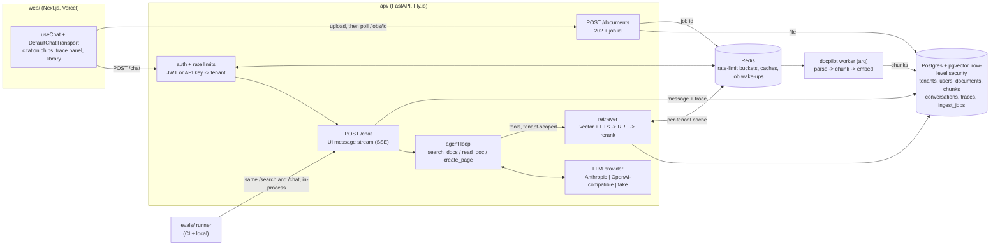

# DocPilot

Upload documents (PDF, Markdown, HTML) and chat with an agent that answers from them, cites the exact
source chunk for every claim, and can draft new pages back into your library. Every answer comes with
a trace (retrieved chunks, tool calls, tokens, latency, cost), and an eval suite scores retrieval and
answer quality on every PR.

- **Agentic RAG:** the model decides when to call `search_docs`, `read_doc` and `create_page`. Search is not hard-wired into every turn.
- **Hybrid retrieval:** Postgres full-text and pgvector results are fused with reciprocal rank fusion (RRF), then optionally reranked. The retrieval mode is a flag, so ablations are one command.
- **Streaming with inline citations:** FastAPI emits the Vercel AI SDK UI message stream, and the Next.js `useChat` renders `[c:<id>]` markers as clickable chips.
- **Multi-tenant, enforced twice:** every query filters by tenant, and Postgres row-level security enforces the same rule, so tenant A can never retrieve tenant B's chunks, even through the agent's tools or a forged citation. Accounts use argon2id passwords, 15-minute JWT access tokens and single-use refresh tokens that detect replay. See [docs/backend.md](docs/backend.md).
- **One Postgres holds everything:** documents, chunks, vectors, conversations, traces and ingest jobs. Redis holds only what can be lost: shared rate limits, per-tenant caches, and wake-up messages for the ingest worker.
- **Evals in CI:** 110 labeled questions over a fixed corpus. The workflow reports recall@5, MRR, LLM-judged correctness, citation faithfulness and refusals, and posts the diff against a baseline as a PR comment.

## Architecture



**One chat turn:**
1. The client POSTs `{id, messages}`.
2. The API loads earlier turns from Postgres and runs the agent loop: stream a model turn, run the tools it asked for, send all results back in one message, and repeat (at most `MAX_AGENT_STEPS` turns).
3. Text and tool events are streamed as UI-stream parts.
4. At the end, the API resolves the cited chunk ids against the DB (a hallucinated id produces no citation), saves the message and its `traces` row, and sends `data-citations` and `data-trace` parts.

## Quickstart (Docker)

```bash
cp .env.example .env            # add ANTHROPIC_API_KEY + OPENAI_API_KEY (embeddings)
docker compose up --build       # web :3000, api :8000, postgres :5432, redis, ingest worker
```

Compose runs the API with two processes and `INGEST_MODE=queue`: uploads return at once and the worker indexes them while the Library page shows progress. To enable user accounts, set `JWT_SECRETS` in `.env`; then `POST /auth/register` creates a user with their own tenant.

No keys? Set `LLM_PROVIDER=fake` and `EMBEDDING_PROVIDER=fake` in `.env`. The whole app then runs offline with a scripted model and a hashed bag-of-words embedder.

To load the sample corpus, upload `evals/corpus/*.md` on the Library page, or run:
`docker compose exec api docpilot ingest /corpus`.

## Local development (no Docker)

You need Postgres 16 with pgvector. A free Neon or Supabase database also works: append `?sslmode=require` to `DATABASE_URL`.

```bash
# API
cd api
python -m venv .venv && source .venv/bin/activate      # Windows: .venv\Scripts\activate
pip install -e ".[dev]"
docpilot db init                                         # idempotent: extension, tables, indexes
docpilot ingest ../evals/corpus                          # optional sample docs
uvicorn docpilot.app:app --reload --port 8000
# Windows without --reload: add  --loop asyncio:SelectorEventLoop  (psycopg async needs it)
# Optional, with REDIS_URL set: shared rate limits, caches, and the ingest queue
INGEST_MODE=queue docpilot worker                        # alongside an API with INGEST_MODE=queue

# Web
cd web
npm install
API_URL=http://localhost:8000 npm run dev                 # http://localhost:3000

# Tests
cd api && pytest                       # unit tests need no DB and no keys
DATABASE_URL=postgresql://... pytest   # + DB-backed tests: tenant isolation, RLS, auth, jobs
REDIS_URL=redis://localhost:6379/15 DATABASE_URL=... pytest   # + Redis: limits, caches, worker (flushes db 15)
```

API dependencies are pinned in `api/requirements.txt`, which the Docker image installs. After changing `pyproject.toml`, regenerate it:
`uv pip compile api/pyproject.toml --generate-hashes --python-version 3.12 -o api/requirements.txt`.

## Using the LLM Gateway

The `openai` provider talks to any OpenAI-compatible `/v1/chat/completions` and `/v1/embeddings` endpoint. To route all model traffic through the gateway:

```bash
LLM_PROVIDER=openai
OPENAI_BASE_URL=http://localhost:8080/v1   # the gateway
OPENAI_API_KEY=<gateway key>
CHAT_MODEL=<model name the gateway routes>
EMBEDDING_PROVIDER=openai                  # embeddings go through the same base URL
EMBEDDING_MODEL=text-embedding-3-small     # must support dimensions=1024
```

Tool calls, streaming and token usage (`stream_options.include_usage`) all go through the gateway unchanged. Cost per trace uses the price table in `api/src/docpilot/pricing.py`. Models missing from that table are recorded at $0 and a warning is logged.

## Evals

The fixed corpus `evals/corpus/` is a 14-doc wiki for a fictional startup, Lumen Labs. `evals/dataset.jsonl` has 110 questions:
- 62 single-document
- 37 multi-document
- 11 unanswerable

Each answerable question cites its evidence as a verbatim quote. A retrieved chunk counts as relevant if it contains the quote, so the labels survive re-chunking. `python -m evals.dataset` checks that every quote exists in its document.

| Metric | How |
|---|---|
| recall@5, MRR | Quote-matched relevance on `POST /search` results, per retrieval mode |
| correctness | LLM judge (Claude, structured JSON verdict) against the reference answer |
| citation faithfulness | Judge checks that the cited chunk text supports each cited claim |
| refusal accuracy / false refusals | On unanswerable / answerable questions |
| cited-evidence rate | Deterministic: did any cited chunk contain a gold evidence quote |
| latency p50/p95, cost | From the per-turn traces |

```bash
# from the repo root, with DATABASE_URL set (uses an isolated schema: docpilot_eval)
python -m evals.run --retrieval-only                         # cheap: retrieval ablation
python -m evals.run --modes vector,hybrid --rerankers none,cohere
python -m evals.run                                          # + answers via /chat + judge
python -m evals.compare evals/results/<run>.json            # diff vs evals/baseline.json
python -m evals.spotcheck evals/results/<run>.json -n 20    # hand-review sheet for the judge
```

CI (`.github/workflows/evals.yml`) runs on PRs that touch the agent prompt or tools, chunking, or retrieval, and updates a sticky comment with the diff. Without an `OPENAI_API_KEY` secret it falls back to the fake embedder. Without an `ANTHROPIC_API_KEY` secret it runs retrieval only. The comment says when either fallback was used.

### Public retrieval benchmarks

The 14-doc wiki has too few chunks (32) to separate retrievers, so `evals/benchmarks.py` also scores retrieval on four public datasets. It needs no LLM, and the data stays out of the repo.

| dataset | what it tests | gold labels |
|---|---|---|
| HotpotQA (distractor config) | multi-hop questions over Wikipedia intros | human, both supporting articles |
| MultiHop-RAG | long news articles, null queries | verbatim evidence quotes |
| BEIR FiQA | vocabulary gap, published BM25 baselines | human qrels |
| RAGBench TechQA | real IBM technotes | GPT-4 annotations (weak) |

```bash
pip install -e "api[dev,benchmarks]"
export EVAL_DATA_DIR=/path/with/space
python -m evals.benchmarks download
python -m evals.benchmarks run --rerankers none,cohere --limit 1000
```

Check each dataset's license before redistributing it. Ingest embeds about 16M words, so use a GPU or budget for the API cost.

Results below use local models (`BAAI/bge-m3` embeddings, `BAAI/bge-reranker-v2-m3` reranker), not the OpenAI and Cohere models configured by default, so only the full-text column is independent of the model choice. Up to 1000 sampled questions per dataset, 500/60 token chunks. Reranked figures use `top_k=5`, as the agent does.

| dataset | chunks | questions | vector | BM25 | hybrid | hybrid + rerank |
|---|---|---|---|---|---|---|
| HotpotQA | 66,697 | 1000 | 0.700 | 0.711 | 0.753 | 0.870 |
| MultiHop-RAG | 3,447 | 893 + 107 null | 0.430 | 0.527 | 0.523 | 0.536 |
| BEIR FiQA | 60,924 | 648 | 0.391 | 0.228 | 0.354 | 0.394 |
| RAGBench TechQA | 7,088 | 132 | 0.542 | 0.593 | 0.612 | 0.575 |

Values are nDCG@10. `top_k=5` returns only five chunks, which caps the rerank column's nDCG@10; compare it with the others on recall@5 in the results file (for example, HotpotQA 0.746 hybrid against 0.868 reranked).

What this changed:
- Full-text search originally ranked with Postgres's `ts_rank_cd`, which has no inverse document frequency. It scored 0.061 on FiQA and pulled hybrid below vector-only on three of the four datasets. The 14-doc wiki couldn't show this. BM25 scores 0.228, close to the published baseline of about 0.25.
- Chunks stay at 500 tokens: 300 tokens looked equally good on the wiki but significantly lowered recall@5 on MultiHop-RAG (-0.062, 95% CI -0.077 to -0.047).

### Public answer benchmarks

HotpotQA and MultiHop-RAG also ship short reference answers, so `evals/bench_matrix.py` runs the agent end to end over the schemas ingested above. It crosses each dataset with all six retrieval settings: vector, BM25 (`fts`) or hybrid, each with and without the reranker. Every setting answers the same seeded sample of questions, and the script writes one table per dataset with retrieval recall, answer accuracy and latency, plus paired confidence intervals against plain hybrid. Answers are scored by matching the normalized reference answer, with no LLM judge. Add `closed-book` to `--combos` to also run the agent over an empty library, which shows how much the model answers from memory.

```bash
python -m evals.bench_matrix --llm openai --out evals/results/matrix   # rerun the same --out to resume
```

`evals/baseline.json` was produced offline with the **fake embedder** (retrieval only). After the first real run, regenerate it with `python -m evals.run --output evals/baseline.json` and commit it.

### Results: TO FILL after first real run

| retrieval | recall@5 | MRR |
|---|---|---|
| vector only | TBD | TBD |
| full-text only | TBD | TBD |
| hybrid (RRF) | TBD | TBD |
| hybrid + rerank | TBD | TBD |

| answers (hybrid) | value |
|---|---|
| correctness | TBD |
| citation faithfulness | TBD |
| refusal accuracy | TBD |
| p50 latency / cost per question | TBD |

## Production notes

- **Access:** in production the API needs `API_KEYS`, `JWT_SECRETS` or both. A user's access token scopes every request to their tenant. An API key acts on tenant 1, and the web app's server-side proxy (`web/src/app/api/backend`) uses one, so the web UI currently shows tenant 1's library. `WEB_PASSWORD` puts Basic Auth on the site. A login screen in the web app is not built yet; the API's account endpoints are.
- **Tenant isolation:** the app's database connections run as `DB_APP_ROLE` (created by `docpilot db init`, which needs `CREATEROLE`), so row-level security applies to them. On a host where you can't create roles, set `DB_APP_ROLE=` to rely on the query filters alone. Details and the threat model: [docs/backend.md](docs/backend.md).
- **Rate limits:** per user (token) or per client IP, shared by all instances through Redis. Without `REDIS_URL`, or while Redis is down, each instance keeps its own buckets, so N instances allow N times the limit. Web traffic counts as one client unless you set `TRUST_FORWARDED_FOR=true` on the web app and `CLIENT_IP_HEADER=x-client-ip` on the API. Only do that behind a platform that overwrites `x-forwarded-for` (Vercel does), because Next.js otherwise passes on whatever the client sent.
- **Load:** with fake models, on a busy shared 40-thread machine, 50 closed-loop users got 452 req/s (search p95 160 ms, full chat stream p95 100 ms, 0 errors), and the per-tenant cache added 35% throughput. 200 users with think time saw search p95 93 ms. Method, caveats and what the runs taught: [docs/backend.md](docs/backend.md#load-test).
- **Ingest:** with `INGEST_MODE=queue`, uploads are stored in Postgres and indexed by `docpilot worker`. Redis only carries wake-ups, so losing it delays jobs but doesn't lose them.
- **Failures:** if embeddings or the reranker are down, retrieval degrades to what still works. A chat turn stops at `CHAT_TIMEOUT_SECONDS`. Clients get a request id, and details stay in the logs.
- **Untrusted documents:** text from documents can't forge chunk boundaries, citations must point at chunks the model was shown, and answers with no valid citation are flagged in the UI. This limits prompt injection but does not prevent it: a document can still influence what the model writes.
- **Schema changes:** add a numbered file to `api/src/docpilot/migrations/` and never edit an applied one. `docpilot db init` applies pending files in order. Migrations only go forward, so write a new one to undo a change.

## Deploy

**API on Fly.io** (`api/fly.toml`):
1. Run `fly launch --no-deploy` from `api/`.
2. Set secrets: `fly secrets set DATABASE_URL=... REDIS_URL=... API_KEYS=... JWT_SECRETS=... ANTHROPIC_API_KEY=... OPENAI_API_KEY=...`. With `ENVIRONMENT=production` (set in `fly.toml`) the API refuses to start without `API_KEYS` or `JWT_SECRETS`. For Redis, `fly redis create` (Upstash) works.
3. Run `fly deploy`. The release command runs `docpilot db init`. `/readyz` is the health check; `/healthz` only says the process is up. `fly.toml` defines two process groups, `app` and `worker`; scale them separately with `fly scale count app=2 worker=1`.
4. Set `CORS_ORIGINS` to your Vercel URL.

**Database:** Neon or Supabase free tier. Both support `CREATE EXTENSION vector`.

**Web on Vercel:**
1. Import the repo with root directory `web/`.
2. Set `API_URL=https://<your-app>.fly.dev`, `API_KEY` (one of the API's `API_KEYS`), `WEB_PASSWORD` and `TRUST_FORWARDED_FOR=true`.
3. Vercel caps request bodies at about 4.5 MB, so larger uploads need the Docker deployment instead.

## Repo map

```
api/
  src/docpilot/
    app.py              FastAPI factory, lifespan, CORS, /healthz
    config.py           all settings (env vars)
    db.py, migrations/  connection pool, tenant-scoped transactions (RLS), versioned migrations
    store.py            raw SQL for documents, messages, traces (every query tenant-scoped)
    auth.py             argon2id passwords, JWT access tokens, rotating refresh tokens
    security.py         who is calling (user / API key) and rate limits (Redis or local)
    cache.py            per-tenant query-embedding and search-result caches (Redis)
    jobs.py, worker.py  background ingest: job table, progress, retries, sweeper (arq)
    ingest/             parse (PDF/HTML/MD) -> heading-aware chunker -> pipeline
    embeddings.py       openai-compatible | fake
    retrieval/          search.py (vector/fts/hybrid), fusion.py (RRF), rerank.py (Cohere)
    llm/                provider adapters: anthropic, openai-compatible, fake
    agent/              loop.py, tools.py, prompts.py, citations.py
    chat_stream.py      agent events -> AI SDK UI message stream (ui_stream.py = wire format)
    routes/             documents.py (+ /search), chat.py (+ conversations, traces), auth.py, jobs.py
  tests/                unit tests (no DB/keys); DB-backed: tenancy, auth, jobs; Redis-backed
web/src/
  app/                  / (chat), /library
  components/           Chat, AnswerText (citation chips), SourcePanel, TracePanel, Library
  lib/                  api client, shared types
evals/
  corpus/, dataset.jsonl, baseline.json
  run.py, metrics.py, judge.py, compare.py, spotcheck.py, dataset.py
loadtest/
  locustfile.py         many tenants searching, chatting and uploading at once
  hnsw_filter.py        vector search under a tenant filter: plans, latency, rows returned
docs/backend.md         tenancy, RLS, accounts, Redis, ingest queue, load test results
```
